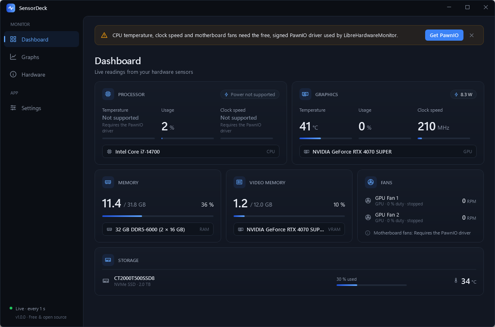
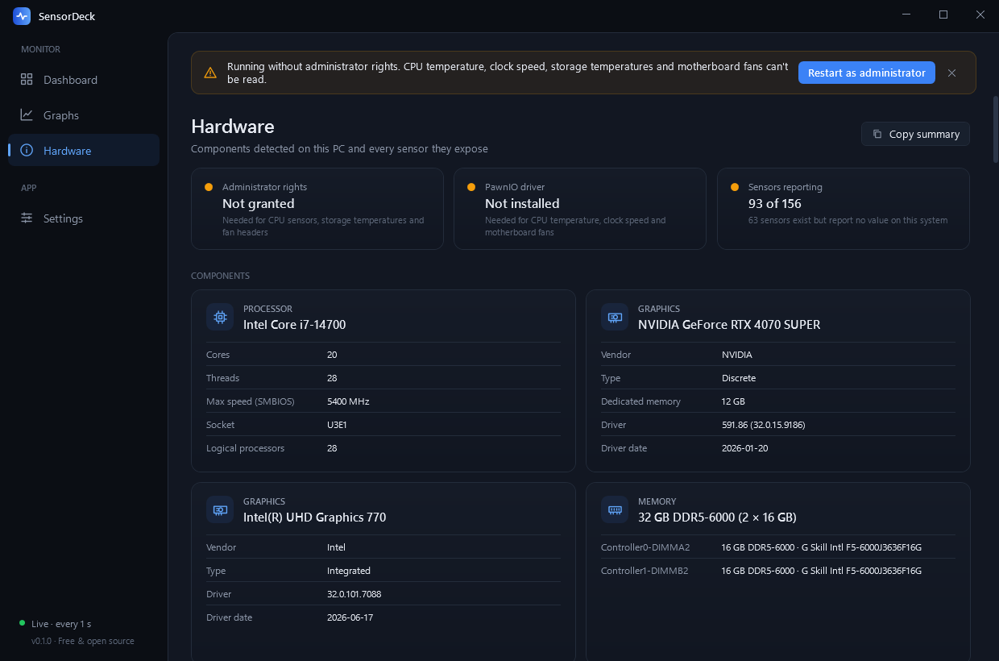

# SensorDeck

A free, lightweight hardware monitor for Windows with a modern dark interface.
Every reading comes from a real hardware sensor (via [LibreHardwareMonitor](https://github.com/LibreHardwareMonitor/LibreHardwareMonitor)).
Anything your hardware, drivers or permissions don't expose is shown as **Not supported** with the reason, never as a fake `0`.

**[Website](https://jaxongate-web.github.io/SensorDeck/) · [Download for Windows](https://github.com/jaxongate-web/SensorDeck/releases/latest/download/SensorDeck-setup.exe) · [All releases](https://github.com/jaxongate-web/SensorDeck/releases)**



## Features

- **Dashboard** — CPU and GPU temperature, usage, clock speed and power; RAM and VRAM usage; fan speeds; storage temperatures and used space.
  Every card names the detected device (e.g. *Intel Core i7-14700*, *NVIDIA GeForce RTX 4070 SUPER*, *32 GB DDR5-6000 (2 × 16 GB)*, *NVMe SSD · 2.0 TB*).
- **Live graphs** — CPU/GPU usage, temperatures and clocks, memory, VRAM and per-drive temperatures over 1, 5 or 10 minutes, with hover readouts and min/avg/max.
- **Hardware page** — processor, graphics (with driver version), memory modules, motherboard and BIOS, drives and Windows version, plus a searchable table of every raw sensor.
  **Copy summary** puts a plain-text spec sheet on the clipboard.
- **Settings** — °C/°F, refresh rate (0.5–5 s), default graph range, warm/hot colour thresholds, always on top, minimise/close to the system tray (with live temperatures in the tray tooltip), start minimised and start with Windows.
- **Lightweight** — one background sensor thread, custom-drawn graphs (no chart library), ~3 % of one CPU core and ~150 MB RAM at a 1-second refresh.
- **Private and free** — no ads, no accounts, no telemetry; it never connects to the internet. MIT licensed.



## Install

Get it from the [website](https://jaxongate-web.github.io/SensorDeck/) or the [releases page](https://github.com/jaxongate-web/SensorDeck/releases/latest):

| File | What it is |
|---|---|
| `SensorDeck-setup.exe` | Installer — Start-menu shortcut, optional desktop icon, uninstaller in *Settings → Apps*. Also attached with the version in its name. |
| `SensorDeck-portable.zip` | Portable — unzip anywhere and run `SensorDeck.exe`. |
| `SHA256SUMS.txt` | Checksums to verify your download (`Get-FileHash <file>` in PowerShell). |

Requirements: Windows 10 (1809) or Windows 11, 64-bit. Nothing else — .NET is built in.

**Administrator permission:** Windows asks for it each time SensorDeck starts, because reading CPU, storage and motherboard sensors requires it.

**PawnIO driver (recommended):** CPU temperature, CPU clock speed and motherboard fan headers are read through the free, signed
[PawnIO](https://pawnio.eu/) driver used by LibreHardwareMonitor. SensorDeck shows a banner with a download link if it isn't installed;
everything else works without it.

**"Windows protected your PC":** release builds aren't code-signed yet, so SmartScreen may warn on first run.
Click **More info → Run anyway**. You can verify the file against `SHA256SUMS.txt` first.

## What can and can't be read

| Reading | Needs |
|---|---|
| GPU temperature, usage, clocks, VRAM, fans, power | Nothing extra (NVIDIA/AMD/Intel drivers) |
| CPU usage, RAM usage | Nothing extra |
| Storage temperature and SMART data | Administrator |
| CPU temperature, CPU clocks, CPU power, motherboard fans | Administrator **and** PawnIO |

Some laptops and OEM motherboards don't expose fan sensors at all, and some USB/RAID drives don't report temperatures —
SensorDeck labels those as not supported.

## Build from source

Requirements: [.NET 10 SDK](https://dotnet.microsoft.com/download/dotnet/10.0); [Inno Setup 6](https://jrsoftware.org/isinfo.php) for the installer
(`winget install JRSoftware.InnoSetup`).

```powershell
dotnet build SensorDeck.sln          # Debug build (runs without admin; elevated readings show as not supported)
dotnet test                          # unit tests
.\build\release.ps1                  # tests + self-contained exe + portable zip + installer + checksums → .\dist
.\build\release.ps1 -SkipInstaller   # same, without Inno Setup
```

The version number lives in `Directory.Build.props`. `tools\make-icon.ps1` regenerates the app icon.

### Project layout

```
src/SensorDeck.Core     Sensor layer: LibreHardwareMonitor access, vendor-aware sensor selection,
                        hardware identification, history buffers, settings storage
src/SensorDeck.App      WPF app (MVVM): theme, dashboard, graphs, hardware page, settings, tray
src/SensorDeck.Probe    Console tool that dumps every sensor on the current PC (for diagnosing hardware)
tests/                  xUnit tests (sensor selection with fake hardware, formatting, settings, axis scaling)
installer/              Inno Setup script
build/release.ps1       Release build script
docs/                   Website (served by GitHub Pages) and README screenshots
tools/                  Icon generator and local website preview (serve-site.ps1)
```

### Releasing a new version

1. Bump `<Version>` in `Directory.Build.props`, commit and push.
2. Run `.\build\release.ps1`.
3. `gh release create vX.Y.Z --generate-notes dist\*`

The website's download button links to `releases/latest/download/SensorDeck-setup.exe`, so it serves the new version automatically.

Settings are stored in `%AppData%\SensorDeck\settings.json`.

## Licence

SensorDeck is released under the [MIT licence](LICENSE). It bundles open-source components under their own licences —
see [THIRD-PARTY-NOTICES.txt](THIRD-PARTY-NOTICES.txt).
